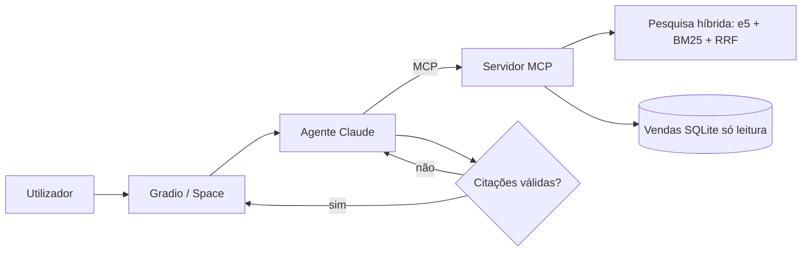

# [Nome do projeto]

> Modelo de documento de projeto para o portfólio. Substitui cada secção pelo teu caso; os exemplos entre parênteses são do copiloto da Loja Lusa.

## 1. Problema

- **Quem tem o problema e com que frequência?** (Colaboradores perdem 20 a 40 minutos por dia à procura de regras em PDFs e a pedir números à equipa de dados.)
- **Como se resolve hoje e quanto custa?** (Emails ao RH e pedidos de relatórios, com resposta em 1 a 2 dias.)
- **O que fica fora do âmbito?** (Decisões sobre pessoas, alterações a dados, informação de clientes.)

## 2. Métricas de sucesso

| Métrica | Alvo | Como se mede |
|---|---|---|
| Respostas corretas no golden dataset | ≥ 85 % | `avaliar.py`, juiz + verificações determinísticas |
| Citações válidas | 100 % | Verificação por código |
| Recusa em perguntas fora do âmbito | ≥ 95 % | Casos `fora_de_ambito` e `seguranca` |
| Latência p50 | < 15 s | `avaliar.py` |
| Custo por pergunta | < US$0,05 | Tokens × preço |
| (Negócio) Pedidos ao RH sobre políticas | −30 % em 3 meses | Registo de tickets |

## 3. Arquitetura

## 4. Decisões e alternativas

| Decisão | Escolha | Alternativas consideradas | Porquê |
|---|---|---|---|
| Recuperação | Híbrida (densa + BM25, RRF) | Só densa; reranker | Termos exatos (códigos de erro, valores) falham na pesquisa densa; reranker fica para quando houver mais documentos |
| Ligação a dados | MCP | Ferramentas diretas no código | O mesmo servidor serve o copiloto, o Claude Desktop e outros agentes |
| Modelo | Sonnet para o agente | Haiku; modelo aberto | Melhor uso de ferramentas; o Haiku é a primeira coisa a testar para baixar custo |
| Índice | numpy em ficheiro | Qdrant | 24 chunks não justificam um servidor; Qdrant a partir de dezenas de milhares |
| Guardrails | Base só de leitura, citações verificadas, instruções em dados ignoradas | Moderação externa | Os riscos principais são inventar e alterar dados, e estão cobertos por código |

## 5. Resultados

(Cola aqui o `relatorio_avaliacao.md`, com a data e a versão.)

## 6. Custos

| Componente | Custo |
|---|---|
| Por pergunta (média) | US$… |
| Por 1000 perguntas | US$… |
| Alojamento da demo | Space gratuito (CPU) |

## 7. Riscos e limitações

- Documentos desatualizados geram respostas desatualizadas: o índice tem de ser reconstruído quando mudam.
- O juiz é um modelo: os resultados da avaliação têm erro; uma amostra foi revista à mão (indica quantas).
- AI Act: risco mínimo (assistente interno sem decisões sobre pessoas); a interface identifica-se como IA.

## 8. Próximos passos

1. …
2. …
